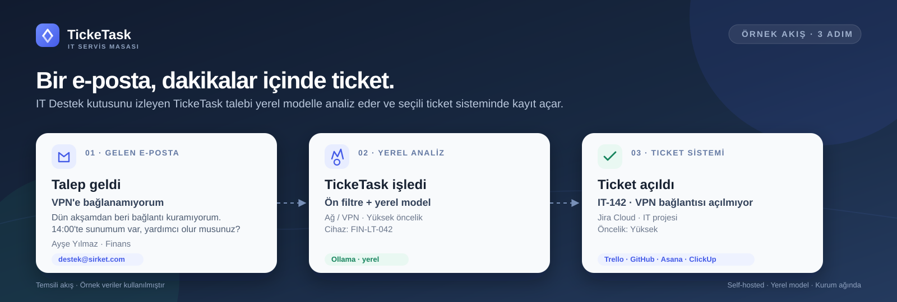

# TickeTask

Kurum içi BT taleplerini toplayan, yerel dil modeliyle ticket taslağı hazırlayan ve Jira Cloud, Trello, GitHub Issues, Asana veya ClickUp üzerinde kayıt açan self-hosted servis masası. Çalışan, cihaz ve ağ envanteri de aynı uygulamadan yönetilir.

Mesajlar, izin listeleri, entegrasyon anahtarları ve ticket geçmişi yerel SQLite veritabanında tutulur. E-posta içeriği ve model çağrıları kurum ağından çıkmaz.



## Öne çıkanlar

- **Arka planda otomatik ticket:** Mail poller uygulama içinde çalışır; arayüz kapalıyken de gelen kutusunu kontrol eder ve uygun e-postaları seçili ticket sisteminde kayda dönüştürür.
- **Yerel ticket yönetimi:** Her ticket; durum, atanan kişi, düzenlenebilir alanlar ve ekip notlarıyla TickeTask içinde yönetilir. Harici sisteme gönderim ayrı ve isteğe bağlı bir adımdır.
- **Yalnızca LLM analizi:** Mesajın ticket'a dönüşüp dönüşmeyeceğine ve taslağın içeriğine yerel model karar verir; kural tabanlı bir yedek analiz kullanılmaz. Model erişilemezse işlem hata olarak görünür ve yeniden denenir.
- **Envanter bağlamı:** Gönderen e-posta adresi envanterdeki kişi ve cihazlarla eşleştirilir; doğrulanan kişi/cihaz bilgisi ticket açıklamasına ve harici sistem kaydına eklenir.
- **Kaynak korunur:** LLM'in düzelttiği açıklamanın altına özgün kaynak mesaj ayrı bir bölüm olarak eklenir.
- **Beş ticket hedefi:** Jira Cloud, Trello, GitHub Issues, Asana ve ClickUp. Hedef kurum genelinde, harici taraflarda veya tek tek ticket'larda seçilebilir.
- **Çoklu mail kutusu ve modern kimlik doğrulama:** Aynı kurulumda en fazla 10 hesap tanımlanabilir. IMAP kullanıcı adı + parolasının yanı sıra Microsoft 365 Graph ve Google Workspace Gmail API desteklenir.
- **Otomatik e-posta değerlendirmesi:** Otomatik yanıt, bülten ve toplu e-posta işaretleri modele bağlam olarak verilir; ticket açılıp açılmayacağına model karar verir.
- **İlk tarama koruması:** İlk çalıştırmada eski e-postalar varsayılan olarak işlenmez; istenirse mevcut iletiler de sırayla alınır.
- **Deneme → canlı geçişi:** Önce hedef sisteme yazmadan analiz sonucu görülür, doğrulandıktan sonra canlı moda geçilir.
- **Kurulum sihirbazı:** Token, hedef, model, mail hesabı ve izin listesi için adım adım yönlendirme.
- **Yerel model yönetimi:** Ollama modeli uygulamanın içinden indirilir, iki disk konumu arasında taşınabilir ve indirme ilerlemesi arayüzden izlenir.
- **Tek komutla Docker:** `docker compose up -d --build` hem TickeTask'ı hem Ollama'yı başlatır; servis sağlık kontrolleri hazır olmadan trafik almaz.
- **Güvenli varsayılanlar:** Docker portu yalnızca `127.0.0.1`'e bağlanır, oturum çerezleri `HttpOnly` + `SameSite=Strict`, gizli değerler AES-GCM ile şifrelenir, hassas uç noktalarda hız sınırı vardır.

## Mimari

| Katman | Teknoloji | Sorumluluk |
| --- | --- | --- |
| `TickeTask.Domain` | .NET 8 | Entity, enum ve iş kuralları |
| `TickeTask.Application` | .NET 8 | DTO, servis sözleşmeleri, repository arayüzleri, ticket analizi |
| `TickeTask.Infrastructure` | EF Core, SQLite, MailKit, HtmlAgilityPack | Kalıcılık, IMAP/Graph/Gmail mail sağlayıcıları, şifreleme, entegrasyonlar, yerel model istemcisi |
| `TickeTask.Web` | ASP.NET Core Minimal API | `/api/*` sözleşmeleri, kimlik doğrulama, statik React SPA |
| `TickeTask.Tests` | xUnit | Birim, repository ve API entegrasyon testleri |
| `frontend` | React 19, TypeScript, esbuild | Tek sayfa yönetim arayüzü |

API uç noktaları konuya göre `src/TickeTask.Web/Api/ApiEndpoints.*.cs` partial dosyalarına ayrılmıştır. Veri erişimi repository + unit of work üzerinden yürür. Ayrıntılar için [docs/architecture.md](docs/architecture.md).

## Gereksinimler

- Docker Desktop (Windows/macOS) veya Docker Engine + Compose (Linux)
- En az 8 GB RAM (yerel model için 8–16 GB önerilir)
- Jira Cloud, Trello, GitHub, Asana veya ClickUp hesabı ve hedef proje/liste/depoda izin
- IMAP, Microsoft 365 Graph veya Google Workspace üzerinden erişilebilen bir IT e-posta kutusu

## Docker ile kurulum

```bash
docker compose up -d --build
```

İlk açılışta imaj oluşturulur, veritabanı migrasyonları uygulanır ve gerekli sırlar `data/secrets/` altında üretilir. Compose; Ollama ve uygulama sağlık kontrolleri geçmeden trafik almaz. Tarayıcıda `http://localhost:8787` adresini açın.

Model ilk kez **Ayarlar → Yerel yapay zekâ** bölümünden indirilir. Ollama konteyneri model olmadan da açılır; model hazır değilken manuel analiz açık bir hata döndürür, e-posta kayıtları ise yeniden deneme kuyruğunda bekletilir.

Windows'ta depo kökündeki `start-ticketask.cmd` dosyası da kullanılabilir. Script her çalıştırmada Docker imajını güncel kaynaklardan yeniden oluşturur, eksik imajları çeker, sağlık kontrolünü bekler ve tarayıcıyı açar.

`.env` dosyası zorunlu değildir; varsayılanlar güvenli yerel çalışma için hazırdır. Kurumsal ağa açmak veya HTTPS ters vekil kullanmak için [Güvenlik ve ağ erişimi](#güvenlik-ve-ağ-erişimi) bölümüne bakın.

### İlk giriş

`http://localhost:8787` adresinde yönetici e-postanızı ve `data/secrets/admin-password` dosyasındaki kurulum şifresini girin. Bu ilk giriş yönetici hesabını oluşturur. Ardından **Ayarlar → Şifre ve erişim** bölümünden kalıcı ve güçlü bir şifre belirleyin; kurulum şifresi artık kullanılmaz.

Kurulum şifresini kopyalarken başındaki/sonundaki boşlukları ve satır sonunu almayın. Docker ile çalışırken dosya `data/secrets/admin-password` yolundadır; `dotnet run` ile yerel çalışmada ise `src/TickeTask.Web/.ticketask-runtime/admin-password` kullanılır. Bu iki dosya farklı olabilir. Docker verilerini (`data/`) sildiyseniz uygulama yeni bir kurulum şifresi üretir; eski dosyadaki değer artık geçerli değildir.

> `data/secrets/` dizinini kimseyle paylaşmayın ve yedeklerini şifreli saklayın. `master-key` kaybolursa şifrelenmiş entegrasyon anahtarları ve mail parolaları çözülemez.

Kurulum tamamlandığında **Ayarlar → Kurulum** sayfası sekiz adımın durumunu gösterir:

1. Yönetici şifresini değiştir
2. Seçili ticket sisteminin bağlantısını kur ve test et
3. Hedef proje/liste/depoyu gir
4. Yerel modeli indir
5. IT mail kutusunu bağla
6. İzinli gönderenleri/alan adlarını belirle
7. Deneme modunda bir e-posta işle
8. Canlı moda geç

## Ticket sistemi kurulumu

**Ayarlar → Entegrasyonlar** bölümünde beş sistemden birini seçip kimlik bilgilerini girin. **Ayarlar → Proje yönetimi** bölümünde aynı sistemi ve hedefini belirleyin. Bağlantı testi hem kimlik doğrulamasını hem de hedefe erişimi denetler.

| Sistem | Gerekli bilgiler | Hedef | Ayrıntılı kurulum |
| --- | --- | --- | --- |
| Jira Cloud | Site adresi, e-posta, kullanıcı API token'ı | Proje anahtarı (`IT`) | [jira.md](docs/ticket-systems/jira.md) |
| Trello | API key, token | Liste ID (24 karakter) | [trello.md](docs/ticket-systems/trello.md) |
| GitHub Issues | Fine-grained/classic token, isteğe bağlı Enterprise API adresi | `owner/repo` | [github-issues.md](docs/ticket-systems/github-issues.md) |
| Asana | Personal access token | Proje GID | [asana.md](docs/ticket-systems/asana.md) |
| ClickUp | Personal API token | Liste ID | [clickup.md](docs/ticket-systems/clickup.md) |

Jira'da ticket projenin backlog'unda oluşur; sprint planlaması Jira'da yapılır. Öncelik, etiket ve vade alanları projede mevcut değilse uygun alanlar atlanır, ana ticket yine açılır. Alt görev türü olmayan projelerde alt görevler atlanır. Diğer sistemlerde ticket doğrudan hedefte açılır; öncelik, tür, vade ve alt görevler açıklama gövdesine yazılır. Ek dosyalar yalnızca Jira'ya ve yalnızca web formu akışında yüklenir.

Hedef değiştirildiğinde yalnızca yeni kayıtlar etkilenir. Geçmiş ticket'lar ve yeniden gönderimler özgün hedeflerini kullanır. Harici taraf kayıtlarında proje varsayılanından farklı bir hedef seçilebilir. Ortak kurulum ve sorun giderme notları için [docs/ticket-systems/README.md](docs/ticket-systems/README.md) dosyasına bakın.

## Yerel ticket yönetimi

**Ticket yönetimi** ekranı harici sistemden bağımsız bir servis masası sunar:

- **Durum akışı:** Açık, işlemde, bekliyor, çözüldü ve kapatıldı. Çözüldü/kapatıldı seçildiğinde çözüm zamanı kaydedilir.
- **Atama:** Yönetici veya ticket sahibi bir çalışanı atayabilir. Atanan çalışan yalnızca durumu güncelleyebilir ve not ekleyebilir.
- **Düzenleme:** Başlık, açıklama, tür, öncelik, son tarih ve etiketler yerel olarak değiştirilebilir.
- **Ekip notları:** Her ticket'a kronolojik notlar eklenir; notlar harici sisteme gönderilmez.
- **Gönderim ayrıdır:** `Taslak` veya `Hata` durumundaki ticket'lar hazır olduğunda seçili Jira/Trello/GitHub/Asana/ClickUp hedefine gönderilir. Yerel durum ve notlar harici kayda geri yazılmaz.
- **Kaynak görünürlüğü:** E-posta kaynaklı ticket'larda özgün mesaj ve envanter bağlamı açıklamanın altında ayrı bölümlerde tutulur.

E-posta ile gelen ticket'larda gönderen adresi önce envanter kişileriyle, sonra kişinin cihazları ve mesaj gövdesinde geçen cihaz adlarıyla eşleştirilir. Bulunan kişi ve cihaz; ticket alanlarına, açıklamadaki bağlama ve harici sistem çıktısına eklenir. Kayıt bulunamazsa ticket yine oluşturulur; bağlam bölümünde eşleşme olmadığı belirtilir.

## E-posta ile otomatik ticket

### Desteklenen sağlayıcılar

| Sağlayıcı | Kimlik doğrulama | Ne zaman kullanılır |
| --- | --- | --- |
| **IMAP** | Kullanıcı adı + parola veya uygulama parolası | Şirket içi Exchange, kendi mail sunucusu ve temel kimlik doğrulaması açık hesaplar |
| **Microsoft 365 (Graph)** | OAuth2 client credentials + `Mail.Read` uygulama izni | Microsoft 365 / Outlook kurumsal kutuları; temel kimlik doğrulama kapalı olsa da çalışır |
| **Google Workspace (Gmail)** | OAuth2 refresh token veya domain-wide delegation | Google Workspace kurumsal kutuları |

Her hesap kendi sağlayıcısını kullanır; aynı kurulumda farklı sağlayıcılardan en fazla 10 hesap tanımlanabilir. Sağlayıcı seçimi **Ayarlar → Mail sistemi** bölümündeki hesap kartında yapılır. Parolalar, OAuth istemci sırları, refresh token'lar ve hizmet hesabı JSON'ları AES-GCM ile şifrelenir; kaydedildikten sonra arayüzde gösterilmez.

### IMAP kurulumu

1. Mail sunucunuzdan IMAP adresi, port ve hesap bilgilerini alın. Genellikle `993` + TLS kullanılır.
2. Hesapta iki adımlı doğrulama varsa sağlayıcının verdiği uygulama parolasını oluşturun.
3. Hesap kartında sağlayıcıyı **IMAP** seçin; görünen ad, sunucu, kullanıcı, parola, gelen kutusu (`INBOX`) ve bağlantı türünü girin. SSL/TLS genellikle `993`, STARTTLS ise `143` portunu kullanır.
4. **Mail ayarlarını kaydet** düğmesine basın; **Bağlantı durumu** kartında hesabın **Bağlı** olmasını bekleyin.

> STARTTLS seçeneği sunucunun STARTTLS desteklemesini zorunlu kılar; desteklenmiyorsa bağlantı hata verir. Şifrelenmemiş bağlantıya geri düşülmez. Self-signed sertifikalar reddedilir.

| IMAP sağlayıcısı | Sunucu | Not |
| --- | --- | --- |
| Microsoft 365 / Outlook | `outlook.office365.com`, 993, TLS | Kurumda genellikle OAuth2 zorunludur. Temel kimlik doğrulama kapalıysa Graph sağlayıcısını kullanın. |
| Google Workspace | `imap.gmail.com`, 993, TLS | İki adımlı doğrulama açıksa uygulama parolası gerekir. Kurum politikası IMAP'i kapatmış olabilir. |
| Kurum içi Exchange | `mail.sirket.com` | IMAP servisinin açık olduğunu ve hesabın IMAP erişim yetkisi olduğunu doğrulayın. |
| Diğer | Sağlayıcı belgesi | TLS sertifikası geçerli olmalıdır; self-signed sertifikalar reddedilir. |

> Microsoft 365 veya Google Workspace temel kimlik doğrulamayı kapattıysa aşağıdaki modern sağlayıcılardan birini kullanın.

### Microsoft 365 / Graph kurulumu

1. [Azure portal](https://portal.azure.com) → **Microsoft Entra ID** → **Uygulama kayıtları** → **Yeni kayıt** ile tek kiracılı bir uygulama oluşturun.
2. **API izinleri** → **İzin ekle** → **Microsoft Graph** → **Uygulama izinleri** → `Mail.Read` seçin ve **Yönetici onayı ver** düğmesine basın.
3. **Sertifikalar ve sırlar** → **Yeni istemci sırrı** oluşturun. Değer yalnızca bir kez gösterilir; hemen kopyalayın.
4. **Genel bakış** sayfasından **Dizin (kiracı) ID** ve **Uygulama (istemci) ID** değerlerini kopyalayın. Kiracı alanına `common` yerine dizin ID'sini veya kurum alan adını yazın.
5. TickeTask'ta hesap kartında sağlayıcıyı **Microsoft 365 · Graph** seçin; posta kutusu adresini (`it@sirket.com`), kiracı ID, istemci ID, istemci sırrı ve klasörü girin. Gelen kutusu için `inbox`; gönderilenler için `sentitems` gibi Microsoft Graph iyi bilinen klasör adlarını kullanın. Özel klasörlerde görünen ad değil **klasör ID'si** gerekir.
6. Kaydedin; **Bağlantı durumu** kartında **Bağlı** görmelisiniz.

> İstemci sırlarının bir son kullanma tarihi vardır (genellikle 6-24 ay). Süresi dolduğunda bağlantı kesilir; Azure portalından yeni sır oluşturup TickeTask'a girin. Uygulama izni kiracıdaki tüm posta kutularına erişebilir. Yalnızca IT kutusuna izin vermek için Exchange Online'da [application access policy](https://learn.microsoft.com/exchange/security-and-compliance/application-access-policy) tanımlayın.

### Google Workspace / Gmail kurulumu

**Seçenek A — Hizmet hesabı (kurumsal kurulumlar için önerilir)**

1. [Google Cloud Console](https://console.cloud.google.com) üzerinde proje oluşturun ve **Gmail API**'yi etkinleştirin.
2. **IAM ve Yönetici** → **Hizmet hesapları** → yeni hizmet hesabı oluşturun. Hizmet hesabının **Gelişmiş ayarlar** bölümünde **Google Workspace alan genelinde yetkilendirme** seçeneğini etkinleştirin. Ardından **Anahtarlar** → **Anahtar ekle** → **JSON** ile anahtarı indirin.
3. Google Yönetici konsolu → **Güvenlik** → **API erişimi** → **Alan genelinde yetkilendirme** → yeni istemci ekleyin. Hizmet hesabının istemci ID'sini ve `https://www.googleapis.com/auth/gmail.readonly` kapsamını girin. Yetkilendirmeyi kaydettikten sonra 5-10 dakika bekleyin.
4. TickeTask'ta sağlayıcıyı **Google Workspace · Gmail** seçin; taklit edilecek posta kutusunu (`it@sirket.com`), indirdiğiniz JSON dosyasının tamamını ve etiketi girin. Etiket alanına sistem etiketi (`INBOX`) veya özel etiketin görünen adını/kimliğini (`Label_...`) yazabilirsiniz; görünen adlar otomatik olarak kimliğe çevrilir.
5. Kaydedin; **Bağlantı durumu** kartında **Bağlı** görmelisiniz.

**Seçenek B — OAuth2 yenileme belirteci**

1. Google Cloud Console'da **OAuth izin ekranı**nı oluşturun. Kurum içi kullanım için **Internal** kullanıcı türünü seçin; **Testing** modunda bırakırsanız yenileme belirteci **7 gün** sonra geçersiz olur.
2. **Kimlik bilgileri** → **OAuth istemcisi** → **Web uygulaması** oluşturun. Yetkili yönlendirme adresi olarak `https://developers.google.com/oauthplayground` ekleyin.
3. [OAuth 2.0 Playground](https://developers.google.com/oauthplayground) → sağ üstteki dişli → **Use your own OAuth credentials** → istemci ID ve sırrını girin. 1. adımda **Gmail API v1** → `https://www.googleapis.com/auth/gmail.readonly` seçip yetkilendirin. 2. adımda kodu belirteçle değiştirin ve **Refresh token** değerini kopyalayın.
4. TickeTask'ta istemci ID, istemci sırrı ve refresh token alanlarını doldurun; etiket olarak `INBOX` girin.

> Gmail API'de `gmail.readonly` yeterlidir; uygulama e-postayı okur, silmez ve okundu işaretlemez. `INBOX` etiketi yalnızca gelen kutusundaki postaları alır; arşivlenmiş postalar işlenmez. Hizmet hesabı kullanıyorsanız hem Cloud Console'da alan genelinde yetkilendirmeyi etkinleştirmek hem de Workspace yöneticisinin istemci ID'sini yetkilendirmesi gerekir. Tüketici `@gmail.com` hesapları hizmet hesabıyla taklit edilemez; bunlar için OAuth2 seçeneğini kullanın. Uygulamanın OAuth izin ekranı **Testing** modundaysa 7 günde bir yeni refresh token almanız gerekir.

### İzinli gönderenler

Varsayılan olarak hiçbir adres kabul edilmez. İki yöntem vardır:

- **Alan adı izni:** `sirket.com` eklenirse o alan adındaki tüm çalışanlar talep gönderebilir. Pratik ve önerilen yöntemdir.
- **Tek tek adres:** Daha dar bir izindir. Ad soyad ticket açıklamasına eklenir. Devre dışı bırakılan adres, alan adı izni olsa bile kabul edilmez.

`ALLOWED_SENDERS` ve `ALLOWED_DOMAINS` ortam değişkenleri başlangıç listesi sağlar; yönetim panelinden yapılan değişiklikler bunları geçersiz kılar. İzin listesi yalnızca `From` adresini denetler. Kurum mail sunucusunda **SPF, DKIM ve DMARC** doğrulamasını açık tutun; aksi halde gönderen adresi taklit edilebilir.

### Deneme modu ve canlı mod

1. **Gönderim modu: Deneme — ticket sistemine gönderme** seçin ve mail kanalını açın.
2. IT kutusuna gerçekçi bir test e-postası gönderin.
3. **Mail işlem geçmişi** bölümünde kaydın `Deneme` olarak göründüğünü doğrulayın. Bu modda hedefte ticket açılmaz.
4. Sonucu kontrol edip **Canlı** moda geçin. Bundan sonra yalnızca yeni gelen uygun e-postalar otomatik ticket olur.

İlk çalıştırmada kutu boşaltılmaz, mail okundu işaretlenmez ve silinmez. Varsayılan olarak mevcut mesajlar atlanır; **Mevcut e-postaları da işle** seçeneği açılırsa eski mesajlar da sırayla işlenir. Canlı modda bu, geçmişteki her uygun e-posta için ticket açabilir; dikkatli kullanın.

Boş gövde, yalnızca selamlama/imza, otomatik yanıt (`Auto-Submitted`, `Precedence: bulk`, `List-Unsubscribe`) ve teslim edilemeyen posta niteliğindeki mesajlar da yerel modele gönderilir. Otomatik/toplu e-posta bilgisi modele ayrı bir bağlam satırı olarak verilir ve son kararı model verir. LLM `actionable=false` dönerse ticket açılmaz. Kural tabanlı bir yedek analiz yoktur; model hatası kalıcı `failed` kaydı oluşturur ve yeniden deneme kuyruğunda tutulur.

### Arka plan çalışması ve tekrar deneme

Mail poller ASP.NET Core hosted service olarak uygulama içinde çalışır ve 5 saniyede bir uyanır; her hesabı seçtiğiniz kontrol aralığında (en az 15 saniye) denetler, ayar değişikliğinde hemen tetiklenir. Her hesap için sağlayıcıya uygun IMAP, Microsoft Graph veya Gmail istemcisi kullanılır. Arayüzün açık olması gerekmez. Başarısız kayıtlar üstel geri çekilmeyle otomatik yeniden denenir; kalıcı olarak reddedilen tek bir mesaj kuyruğu kilitlemez.

Durumu izlemek için:

```bash
docker compose ps
docker compose logs -f app
```

## Yerel model

Model yönetimi uygulamanın içindedir; ayrı bir `model-control` servisi yoktur.

- **Birincil / ikincil konum:** Docker'da `data/ollama` ve `data/ollama-alternative` dizinleridir. İki konum arasında geçiş yapılabilir; eski model dosyaları silinmez.
- **Tam konum:** **Ayarlar → LLM modeli** bölümündeki “Bilgisayardaki tam konum” alanına klasörün tam yolu yazılabilir. Uygulama bilgisayarda doğrudan çalışıyorsa “Bilgisayardan seç” düğmesi işletim sisteminin klasör seçicisini açar. Docker'da seçilen klasörün konteynere bağlı olması gerekir; bunun için `.env` içinde `TICKETASK_MODEL_PRIMARY_ROOT` / `TICKETASK_MODEL_SECONDARY_ROOT` değerlerini kullanın ve `TICKETASK_MODEL_PRIMARY_HOST_PATH` / `TICKETASK_MODEL_SECONDARY_HOST_PATH` ile bilgisayardaki yolu belirtin.
- **Model indirme:** Ollama `/api/pull` akışı kullanılır. Bağlantı kesilirse 5 kez yeniden denenir; `qwen3` modelleri için doğrudan kayıt sunucusundan indirme yedeği vardır.
- **Ollama bağlantısı:** Docker'da `http://ollama:11434`, yerel geliştirmede `http://127.0.0.1:11434`.
- **Model ayarı:** Varsayılan `qwen3:4b`'dir; **Ayarlar → Yerel yapay zekâ** bölümünden model ve adres değiştirilebilir.

Docker'da model dizinleri hem uygulama hem Ollama konteynerine aynı yol altında bağlanır. Uygulama, seçilen konumun `models` klasörüne `/ollama-home/models` bağlantısını oluşturur; Ollama bu bağlantı üzerinden modeli görür. Ollama konteyneri açılışta bu bağlantıyı doğrular; önceki bir çalışmadan kalan bozuk bağlantıyı veya boş `models` klasörünü güvenli biçimde onarır. Dolu bir klasör asla silinmez; yedek adıyla korunur.

## Güvenlik ve ağ erişimi

Varsayılan kurulum yalnızca kurulumu yapan bilgisayardan erişilebilir:

```text
127.0.0.1:8787 -> container:8787
```

Şirket ağındaki diğer bilgisayarlardan erişim gerekiyorsa `.env` dosyasında:

```env
TICKETASK_BIND_ADDRESS=0.0.0.0
```

yapın ve `docker compose up -d` ile yeniden başlatın. **8787 portunu internete veya güvenilmeyen ağlara açmayın.**

Gerçek personel verisi için HTTPS ters vekil kullanın (nginx, Caddy, IIS veya kurumunuzun TLS sonlandırıcısı). Ters vekil arkasında:

```env
APP_PUBLIC_ORIGIN=https://destek.sirket.com
TRUST_PROXY=1
```

ayarlayın. `APP_PUBLIC_ORIGIN`, Origin/CSRF kontrolünde ve güvenli çerez kararında kullanılır. `TRUST_PROXY=1` yalnızca istekleri güvenilir bir ters vekil ilettiğinde açılmalıdır. Proxy'nin `X-Forwarded-Proto: https` gönderdiğinden emin olun.

Ek güvenlik davranışları:

- Giriş, kayıt, analiz, bağlantı testi ve webhook uç noktalarında hız sınırı vardır.
- Oturum çerezleri `HttpOnly`, `SameSite=Strict` ve HTTPS'de `Secure` olarak gönderilir.
- Şifreler PBKDF2-SHA256 (210.000 tur) ile, entegrasyon anahtarları ve mail parolaları AES-GCM ile saklanır.
- Tarayıcı isteklerinde Origin ve `Sec-Fetch-Site` kontrolü yapılır.
- Webhook imzaları sabit zamanlı karşılaştırılır; WhatsApp doğrulama anahtarı tanımlı değilse doğrulama reddedilir.
- Tüm yanıtlara `X-Content-Type-Options`, `X-Frame-Options`, `Referrer-Policy`, `Permissions-Policy` ve uygun olduğunda HSTS başlıkları eklenir.
- Kendi kendine kayıt varsayılan olarak açıktır, ancak yeni hesaplar yönetici onayı olmadan giriş yapamaz. Kapatmak için `ALLOW_SELF_REGISTRATION=0` ayarlayın.
- `/api/health` yalnızca veritabanı ve şifreleme anahtarının hazır olup olmadığını döndürür; yapılandırma veya kişisel veri içermez.

Ayrıntılı güvenlik modeli ve bilinen sınırlamalar için [SECURITY.md](SECURITY.md) dosyasına bakın.

## Webhook entegrasyonları

Jira dışında Trello, GitHub Issues, Asana ve ClickUp hedefleri de desteklenir. Gelen webhook'lar için `.env` içinde güçlü bir `INBOUND_WEBHOOK_TOKEN` tanımlayın ve isteklerde `Authorization: Bearer <token>` gönderin. WhatsApp için `WHATSAPP_VERIFY_TOKEN` ve `WHATSAPP_APP_SECRET` gerekir; imza doğrulanmadan hiçbir mesaj işlenmez. Kullanmıyorsanız bu değişkenleri boş bırakın.

## Veri, yedekleme ve bakım

- Kalıcı veriler `data/` altındadır: SQLite veritabanı, oturumlar, şifrelenmiş ayarlar, mail durumu ve model dosyaları.
- `data/app/ticketask.db` ve `data/secrets/` birlikte yedeklenmelidir.
- `data/secrets/master-key` kaybolursa şifrelenmiş değerler kurtarılamaz.
- Mail durumu `data/app/mail/` altında tutulur; yedeklenmesi önerilir.
- Model dosyaları `data/ollama/` ve `data/ollama-alternative/` altındadır; yeniden indirilebilir.
- Mevcut bir Ollama model dizinini kullanmak için `TICKETASK_MODEL_PRIMARY_ROOT` veya `TICKETASK_MODEL_SECONDARY_ROOT` değerini `models` klasörünün **üst** dizinine ayarlayın (ör. `C:/Users/kullanici/.ollama`), `docker compose up -d` çalıştırın ve arayüzde ilgili konumdan `models` klasörünü seçin.
- Güncellemeden sonra `docker compose up -d --build` çalıştırın. Veritabanı migrasyonları açılışta uygulanır.

### Ortam değişkenleri

Panelden kaydedilen entegrasyon değerleri aynı ada sahip ortam değişkenlerini geçersiz kılar. Boş ortam değişkenleri yapılandırma olarak sayılmaz; böylece Compose'daki boş varsayılanlar panel ayarını ezmez. `MAIL_INGEST_TOKEN`, `APP_MASTER_KEY` ve `APP_ACCESS_PASSWORD` gibi üretilen sırlar ilk açılışta `data/secrets/` altına yazılır.

| Değişken | Varsayılan | Açıklama |
| --- | --- | --- |
| `TICKETASK_DATA_ROOT` | `./data` | Docker veri kök dizini |
| `TICKETASK_MODEL_PRIMARY_ROOT` | `./data/ollama` | Birincil model konumu |
| `TICKETASK_MODEL_PRIMARY_HOST_PATH` | boş | Birincil konumun bilgisayardaki tam yolu (ör. `D:/modeller/ollama`). Arayüzde bu yolu yazınca konteyner yoluna çevrilir. |
| `TICKETASK_MODEL_SECONDARY_ROOT` | `./data/ollama-alternative` | İkincil model konumu |
| `TICKETASK_MODEL_SECONDARY_HOST_PATH` | boş | İkincil konumun bilgisayardaki tam yolu |
| `TICKETASK_MODEL_PRIMARY_LABEL` | `Birinci konum` | Arayüzde görünen konum adı |
| `TICKETASK_MODEL_SECONDARY_LABEL` | `İkinci konum` | Arayüzde görünen konum adı |
| `TICKETASK_BIND_ADDRESS` | `127.0.0.1` | Docker portunun bağlanacağı adres. LAN için `0.0.0.0` |
| `TICKETASK_PORT` | `8787` | Yayınlanan HTTP portu |
| `DATABASE_PATH` | `data/ticketask.db` | SQLite veritabanı yolu |
| `TICKETASK_RUNTIME_ROOT` | `.ticketask-runtime` | Sır dosyalarının dizini |
| `OLLAMA_URL` | `http://127.0.0.1:11434` | Ollama API adresi |
| `MODEL_CONFIG_DIR` | `data/model-config` | Model bağlantı ve seçim durumu |
| `MODEL_PRIMARY_DIR` / `MODEL_SECONDARY_DIR` | `data/model-primary` / `data/model-secondary` | Yerel geliştirmede model kökleri |
| `MODEL_REGISTRY_URL` | `https://registry.ollama.ai/v2/library/qwen3` | Doğrudan model indirme kaydı |
| `MAIL_STATE_DIR` | `data/mail` | Mail poller durum dosyaları (IMAP UID/Graph imleci/Gmail imleci) |
| `APP_PUBLIC_ORIGIN` | boş | Tarayıcıda görünen HTTPS adresi |
| `TRUST_PROXY` | `0` | Güvenilir ters vekil arkasında `1` |
| `ALLOW_SELF_REGISTRATION` | `1` | `0` ise kendi kendine kayıt kapalı |
| `ALLOWED_SENDERS` | boş | Virgülle ayrılmış başlangıç adres listesi |
| `ALLOWED_DOMAINS` | boş | Virgülle ayrılmış başlangıç alan adı listesi |
| `JIRA_BASE_URL` / `JIRA_EMAIL` / `JIRA_API_TOKEN` | boş | Jira başlangıç bağlantı bilgileri |
| `TRELLO_API_KEY` / `TRELLO_TOKEN` | boş | Trello başlangıç bağlantı bilgileri |
| `GITHUB_TOKEN` | boş | GitHub Issues token'ı |
| `GITHUB_API_URL` | boş | GitHub Enterprise API kökü (ör. `https://ghe.sirket.com/api/v3`) |
| `ASANA_TOKEN` | boş | Asana personal access token |
| `CLICKUP_TOKEN` | boş | ClickUp personal API token |
| `INBOUND_WEBHOOK_TOKEN` | boş | Gelen webhook bearer anahtarı |
| `WHATSAPP_VERIFY_TOKEN` | boş | WhatsApp webhook doğrulama anahtarı |
| `WHATSAPP_APP_SECRET` | boş | WhatsApp imza anahtarı |
| `WEBHOOK_OWNER_ID` | `local-user` | Webhook kayıtlarının bağlanacağı yerel kullanıcı |
| `MAIL_INGEST_TOKEN` | üretilir | `/api/mail-ingest` bearer anahtarı |
| `APP_MASTER_KEY` | üretilir | AES-GCM ana anahtarı |
| `APP_ACCESS_PASSWORD` | üretilir | İlk yönetici kurulum şifresi |

## Yerel geliştirme

Gereksinimler: .NET SDK 8.0, Node.js 22 ve isteğe bağlı Ollama.

```bash
npm --prefix frontend ci
npm --prefix frontend run build
dotnet restore TickeTask.sln
dotnet run --project src/TickeTask.Web
```

Uygulama `http://localhost:5127` adresinde açılır. Docker'daki portla aynı olması için:

```bash
dotnet run --project src/TickeTask.Web --urls http://127.0.0.1:8787
```

Yerel çalıştırmada veritabanı `src/TickeTask.Web/data/ticketask.db`, sırlar `src/TickeTask.Web/.ticketask-runtime/` altında oluşur. Windows'ta model bağlantısı için sembolik bağlantı izni yoksa uygulama dizin junction'ı kullanmayı dener.

Frontend'i izleyerek geliştirmek için ayrı bir terminalde:

```bash
npm --prefix frontend run watch
```

Testler:

```bash
dotnet test TickeTask.sln
```

Release derlemesi:

```bash
dotnet publish src/TickeTask.Web/TickeTask.Web.csproj -c Release -o artifacts/web
```

### Yeni EF Core migration

```bash
dotnet ef migrations add <Ad> \
  --project src/TickeTask.Infrastructure \
  --startup-project src/TickeTask.Web \
  --output-dir Persistence/Migrations
```

## Sorun giderme

- **Uygulama açılmıyor:** `docker compose ps` ve `docker compose logs app` çıktısını kontrol edin. İlk kurulumda imajın bitmesini bekleyin.
- **Windows script'i hemen kapanıyor:** Docker Desktop'ın açık ve motorun hazır olduğundan emin olun. Script hata mesajını kapatmadan önce gösterir.
- **8787 portu dolu:** TickeTask zaten çalışıyor olabilir; `docker compose ps` ile kontrol edin. Docker dışı çalıştırmada `--urls` ile başka port seçin.
- **Mail bağlantısı hata veriyor:** Önce seçili sağlayıcıyı doğrulayın. IMAP'te sunucu/port/TLS ve hesap izni; Microsoft Graph'ta kiracı/istemci bilgileri, istemci sırrının süresi ve `Mail.Read` yönetici onayı; Gmail'de `gmail.readonly` kapsamı, refresh token veya hizmet hesabı delegation ayarı kontrol edilmelidir. Gmail OAuth izin ekranı Testing modundaysa refresh token 7 gün sonra geçersiz olur; Graph'ta özel klasörlerde görünen ad değil klasör ID'si gerekir. Hesap kartındaki hata mesajı ve `docker compose logs -f app` ayrıntı verir.
- **Model sunucusuna ulaşılamıyor:** `docker compose ps` ile Ollama'nın çalıştığını, `OLLAMA_URL` değerini ve modelin indirildiğini kontrol edin.
- **Jira 401:** Yönetici API key'i yerine kullanıcı API token'ı ve o kullanıcının e-postasını girin.
- **Veritabanı kilitli:** Aynı veritabanına bağlanan ikinci bir uygulama örneği olup olmadığını kontrol edin; SQLite tek yazıcı destekler.

## Katkı

Katkılar memnuniyetle karşılanır. Değişiklikten önce `dotnet test TickeTask.sln` ve frontend derlemesini çalıştırın. Güvenlik açıklarını herkese açık issue yerine [SECURITY.md](SECURITY.md) içindeki kanaldan bildirin.

## Lisans

[MIT](LICENSE)
